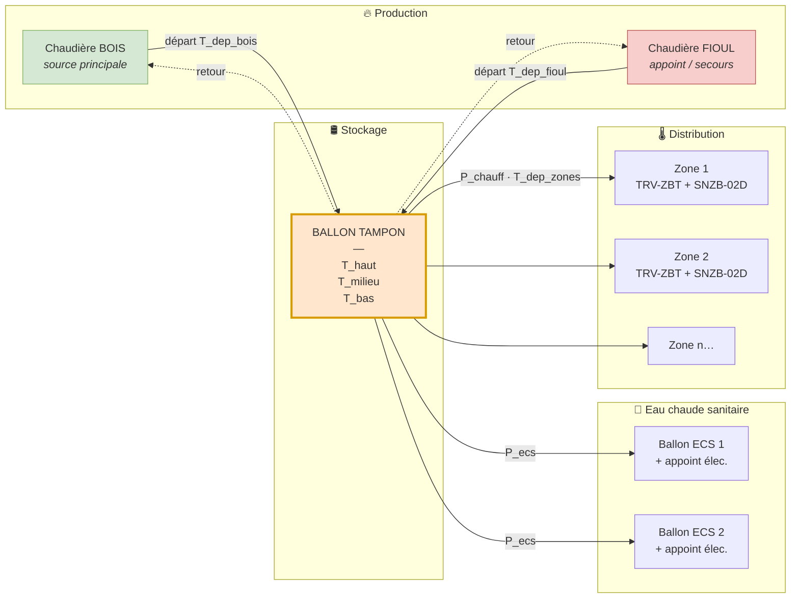

# Chaufferie — schéma hydraulique

> ⚠️ **Schéma de principe à valider sur site.** Il est construit à partir des éléments connus
> (fioul + bois + tampon + 2 ECS + zones), mais plusieurs choix d'architecture restent à vérifier :
> voir [Points à relever](#points-à-relever) en fin de document. Un schéma faux ici produit des
> automatisations fausses — c'est le document à fiabiliser en premier.

## Principe de fonctionnement visé

Le **ballon tampon est le cœur de l'installation** : les deux chaudières y déposent de l'énergie,
tous les usages y puisent. C'est ce découplage qui permet de faire tourner le bois à son régime
optimal sans le piloter au plus juste de la demande.

- Le **bois est prioritaire**. Le **fioul** ne démarre que si le tampon descend sous un seuil
  *et* que le bois ne remonte pas.
- L'**ECS** est chargée depuis le tampon quand celui-ci est assez chaud ; l'appoint électrique
  n'intervient qu'en dernier recours, de préférence sur surplus de production locale.
- Les **zones** régulent indépendamment via les TRV-ZBT, sur la mesure des SNZB-02D.

## Schéma



*Traits pleins : départ (aller chaud). Traits pointillés : retour.*
*`P_xxx` = circulateur. `T_xxx` = point de mesure.*

## Points de mesure

La stratification du tampon est **la mesure la plus importante de l'installation** : c'est elle
qui porte la décision de démarrer le fioul, de charger l'ECS ou de laisser le bois travailler.
Trois sondes au minimum, sinon on ne voit qu'une moyenne qui ne veut rien dire.

| Repère | Emplacement | Sert à |
|---|---|---|
| `T_tampon_haut` | Tampon, ~10 % de la hauteur depuis le sommet | Énergie immédiatement disponible ; autorise la charge ECS |
| `T_tampon_milieu` | Tampon, mi-hauteur | Niveau de charge global ; **seuil de démarrage du fioul** |
| `T_tampon_bas` | Tampon, ~10 % depuis le fond | Tampon vide ; qualité du retour vers les chaudières |
| `T_dep_bois` | Départ chaudière bois | Détection de flambée, fin de combustion |
| `T_ret_bois` | Retour chaudière bois | Écart départ/retour → puissance instantanée |
| `T_dep_fioul` | Départ chaudière fioul | Confirmation de marche réelle du brûleur |
| `T_ecs_1` / `T_ecs_2` | Ballons ECS | Priorité de charge, déclenchement de l'appoint |
| `T_dep_zones` | Départ distribution | Contrôle de la loi d'eau |
| `T_ext` | Extérieur, façade nord à l'ombre | Loi d'eau, degrés-jours |

**Technologie :** sondes **1-Wire (DS18B20)** sur une passerelle dédiée, et non du Zigbee. Trois
raisons : elles sont câblées donc jamais à court de pile, elles supportent le contact direct sur
les doigts de gant, et elles ne consomment pas de place dans le maillage radio. Le Zigbee reste
pour l'ambiance des pièces (SNZB-02D).

## Organes à piloter

| Repère | Organe | Commande |
|---|---|---|
| `C_fioul` | Chaudière fioul | Autorisation de marche (contact sec) |
| `P_chauff` | Circulateur chauffage | Marche/arrêt |
| `P_ecs` | Circulateur charge ECS | Marche/arrêt |
| `V_ecs` | Vanne de basculement ECS / chauffage | Si l'installation en comporte une |
| `R_ecs_1` / `R_ecs_2` | Résistances d'appoint ECS | Via prises S60ZBTPF ou contacteur |

> 🔒 **Principe de dégradation sûre.** Aucun de ces organes ne doit dépendre de Palantír pour
> fonctionner. La régulation d'origine reste en place et opérationnelle ; Palantír **optimise**
> par-dessus. Si le serveur tombe, la maison chauffe toujours — moins finement, mais elle chauffe.

## Points à relever

À vérifier sur site avant de figer le schéma et d'écrire la moindre automatisation :

- [ ] **Le fioul est-il raccordé au tampon, ou directement à la distribution ?** C'est le point le
      plus structurant : s'il alimente la distribution en direct, la logique de priorité change
      complètement.
- [ ] **Y a-t-il une bouteille de découplage** ou un échangeur entre production et distribution ?
- [ ] **Les deux ECS sont-ils en série ou en parallèle** sur le tampon ? En série, le second ne
      chauffe qu'une fois le premier chargé, et la priorité ne se pilote pas de la même façon.
- [ ] **Vanne mélangeuse 3 voies** sur le départ chauffage ? Motorisée ou manuelle ?
- [ ] **Volume du tampon et des ECS** (litres) — nécessaire pour calculer l'énergie stockée.
- [ ] **Doigts de gant disponibles** sur le tampon, et à quelles hauteurs ? À défaut, sondes de
      contact sanglées sous l'isolant.
- [ ] **Type de régulation existante** sur chaque chaudière, et quels contacts sont accessibles
      pour une autorisation externe sans déposer la garantie ni la sécurité.
- [ ] **Vase d'expansion, soupape, disconnecteur** : à reporter sur le schéma pour la vue 3D.

## Calcul de l'énergie stockée

Une fois le volume connu, l'énergie disponible dans le tampon s'estime à partir des trois sondes,
chacune représentant un tiers du volume :

```
E (kWh) = V (litres) × 1,163 / 1000 × ( (T_haut + T_milieu + T_bas) / 3 − T_retour_zones )
```

C'est une approximation — la stratification réelle n'est pas linéaire — mais elle suffit à décider
du démarrage du fioul et se calcule directement dans un capteur template Home Assistant.

---

*Prochaine étape : une fois ce schéma validé, [vue 3D de la chaufferie](../plan/README.md#étape-3--3d).*
